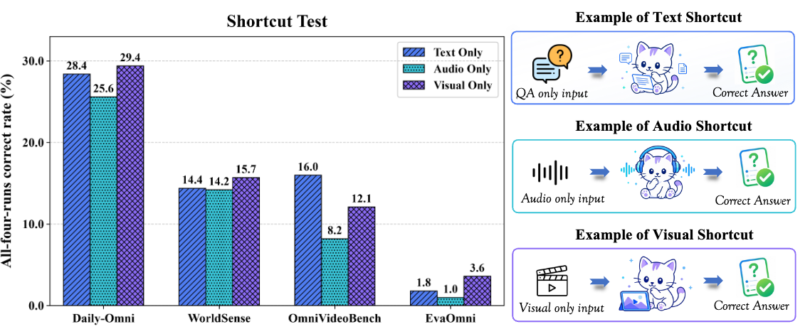
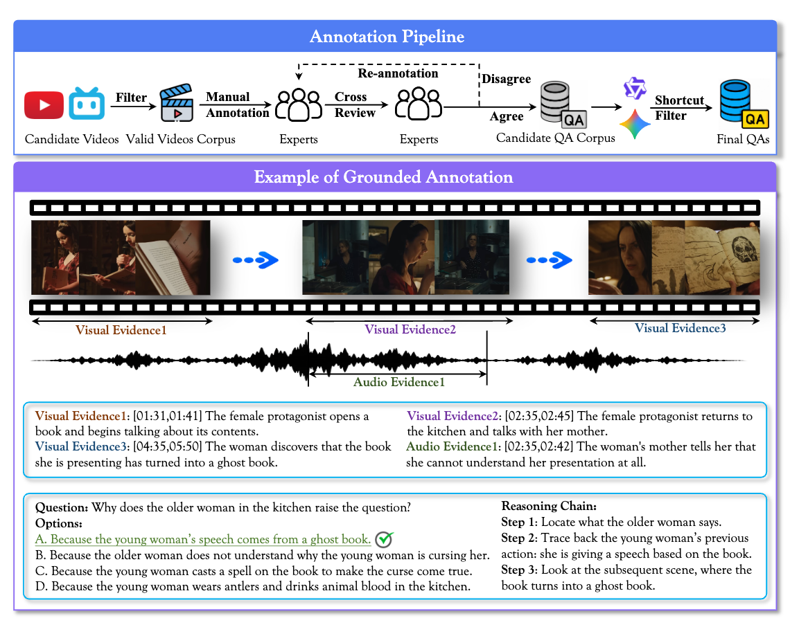
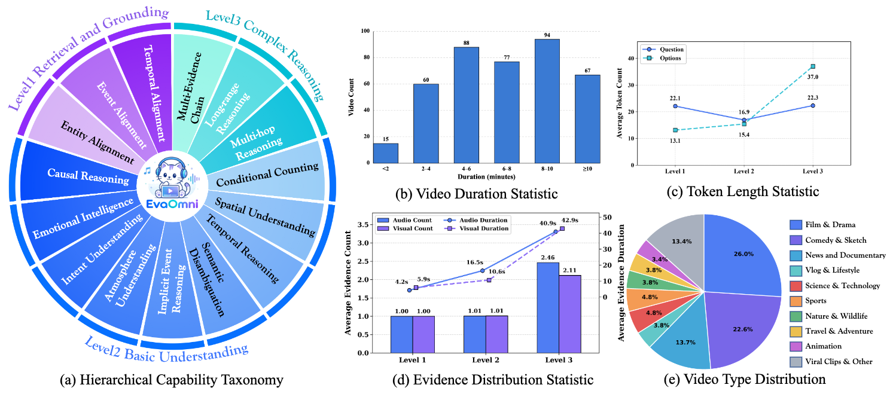

<div align="center">

# EvaOmni : An Evidence-Grounded Benchmark for Audio-Visual Reasoning

<a href="https://scholar.google.com/citations?user=zBM8_XkAAAAJ&amp;hl=zh-CN">Xiaoxing Hu</a><sup>†</sup>, <a href="https://openreview.net/profile?id=~Wenxi_Yao1">Wenxi Yao</a><sup>&#42;</sup>, <a href="https://openreview.net/profile?id=~Chaoyuan_Shi1">Chaoyuan Shi</a><sup>&#42;</sup>, <a href="https://scholar.google.com/citations?user=GA0gV5cAAAAJ&amp;hl=zh-CN">Ziqi Ye</a><sup>&#42;</sup>, <a href="https://openreview.net/profile?id=~Xiaorong_Guo1">Xiaorong Guo</a>, <a href="https://openreview.net/profile?id=~Peixuan_Li3">Peixuan Li</a>, <a href="https://openreview.net/profile?id=~Zhuoran_Sun2">Zhuoran Sun</a>, <a href="https://cuzyoung.github.io/ZiyangGong.github.io/">Ziyang Gong</a>, <a href="https://zzppppy.github.io/">Peiyuan Zhang</a>, <a href="https://openreview.net/profile?id=~Mingxin_Liu3">Mingxin Liu</a>, <a href="https://openreview.net/profile?id=~Shuran_Ma1">Shuran Ma</a>, <a href="https://scholar.google.com/citations?user=GcgqbCUAAAAJ&amp;hl=zh-CN">Hongbo Liu</a>, <a href="https://openreview.net/profile?id=~Xiaomin_Yu1">Xiaomin Yu</a>, <a href="https://t1ans1r.github.io/">Yu Tian</a>, <a href="https://scholar.google.com.hk/citations?user=CX-o0V4AAAAJ&amp;hl=zh-CN">Wentao Wang</a>, <a href="https://github.com/jayyoung0802">Zhenjie Yang</a>, <a href="https://lwpyh.github.io/">Jian Hu</a>, <a href="https://shenyunhang.github.io/">Yunhang Shen</a>, <a href="https://scholar.google.com/citations?user=LV8ejn8AAAAJ&amp;hl=zh-CN">Haoyu Cao</a>, and <a href="https://yangxue.site/">Xue Yang</a><sup>✉</sup>

<sup>†</sup> Project Lead · <sup>&#42;</sup> Core Contributions · <sup>✉</sup> Corresponding Author

<p>
  <a href="https://modelscope.cn/datasets/VisionXLab/EvaOmni-Dataset"></a>
  <a href="https://huggingface.co/datasets/VisionXLab/EvaOmni-Dataset"></a>
  <a href="https://xxx.xxx"></a>
</p>

**If EvaOmni is useful for your research, please consider starring this repository and citing our work！ ⭐⭐⭐**

</div>

## 📖 Motivation & Overview

EvaOmni is an evidence-grounded benchmark for evaluating audio-visual reasoning in omni-modal large language models. Existing multiple-choice benchmarks often score only whether a model selects the correct option. A model can therefore obtain credit from textual, logical, or single-modality shortcuts without identifying the evidence that supports its answer. EvaOmni requires a model to return both an answer and timestamped audio and visual evidence. The benchmark reports answer accuracy together with evidence coverage and temporal grounding, making it possible to measure whether a correct answer is supported by the relevant moments in both modalities.

<p align="center">
  
</p>

*Shortcut evaluation across benchmarks, with examples of text-only, audio-only, and visual-only shortcuts.*

## ✨ Highlights

- **Evidence-grounded evaluation:** models predict an answer together with audio and visual evidence intervals.
- **Audio-visual reasoning:** questions are designed to require complementary information from the two modalities.
- **Shortcut screening:** construction includes text-only, audio-only, and visual-only checks.
- **Fine-grained taxonomy:** 1,027 questions from 392 videos cover 15 capabilities across 3 reasoning levels.
- **Grounded metrics:** Coverage Grounded Score (C.G.) measures evidence coverage, while Bottleneck Grounded Score (B.G.) measures the weaker of the two modality-localization scores.
- **Transparent evaluation:** this initial release includes a runnable metric evaluator, a prediction schema, and a worked example. Provider-specific inference adapters and the original prompt templates are planned.

<p align="center">
  
</p>

*Annotation pipeline and a grounded question example with timestamped audio and visual evidence.*

## 📊 Benchmark Statistics

| Item | Value |
|---|---:|
| Videos | 392 |
| Question-answer pairs | 1,027 |
| Fine-grained capabilities | 15 |
| Reasoning levels | 3 |
| Video duration | 1–12 minutes |
| Evaluation frame rate | 1.0 FPS |
| Evaluation resolution | 480 pixels on the longer side |

<p align="center">
  
</p>

*Capability taxonomy and dataset statistics, including video duration, token length, evidence, and video categories.*

### Capability levels

- **Level 1 — Retrieval and Grounding:** temporal alignment, event binding, and entity binding.
- **Level 2 — Basic Understanding:** causal reasoning, emotional intelligence, intent understanding, atmosphere understanding, implicit event reasoning, semantic disambiguation, temporal understanding, spatial understanding, and conditional counting.
- **Level 3 — Complex Reasoning:** multi-hop reasoning, long-range reasoning, and multi-evidence chains.

## 🔥 Benchmark Performance

The current manuscript evaluates **7 open-weight and 17 proprietary Omni LLMs**, with a human expert reference baseline. The table below reports Acc., C.G., and B.G. for all three capability levels and overall. All values are percentages and higher is better. Within each model group, **bold** indicates the best results and <ins>underlining</ins> indicates the second-best results. These are manuscript results, not outputs generated by this starter release.

<table>
  <thead>
    <tr>
      <th rowspan="2">Model</th>
      <th colspan="3">Level 1 R.&amp;G.</th>
      <th colspan="3">Level 2 B.U.</th>
      <th colspan="3">Level 3 C.R.</th>
      <th colspan="3">Overall</th>
    </tr>
    <tr><th>Acc.</th><th>C.G.</th><th>B.G.</th><th>Acc.</th><th>C.G.</th><th>B.G.</th><th>Acc.</th><th>C.G.</th><th>B.G.</th><th>Acc.</th><th>C.G.</th><th>B.G.</th></tr>
  </thead>
  <tbody>
    <tr><th colspan="13">Open-Weight Omni LLMs</th></tr>
    <tr><td>Qwen2.5-Omni-7B</td><td align="right">16.6</td><td align="right">1.2</td><td align="right">0.6</td><td align="right">17.4</td><td align="right">0.5</td><td align="right">0.0</td><td align="right">13.7</td><td align="right">0.3</td><td align="right">0.0</td><td align="right">16.4</td><td align="right">0.8</td><td align="right">0.3</td></tr>
    <tr><td>Qwen3-Omni-Instruct-30B-A3B</td><td align="right">28.6</td><td align="right">5.1</td><td align="right">0.6</td><td align="right">22.4</td><td align="right">3.4</td><td align="right">0.4</td><td align="right">22.2</td><td align="right">2.4</td><td align="right">0.1</td><td align="right">25.2</td><td align="right">4.0</td><td align="right">0.4</td></tr>
    <tr><td>Qwen3-Omni-Thinking-30B-A3B</td><td align="right">26.3</td><td align="right">11.4</td><td align="right">4.8</td><td align="right">24.4</td><td align="right">6.2</td><td align="right">1.2</td><td align="right">21.6</td><td align="right">4.1</td><td align="right">0.6</td><td align="right">24.8</td><td align="right">8.3</td><td align="right">2.8</td></tr>
    <tr><td>Nemotron3-Nano-Omni-30B-A3B</td><td align="right">30.7</td><td align="right">15.0</td><td align="right">5.3</td><td align="right">22.1</td><td align="right">13.1</td><td align="right">3.9</td><td align="right">10.5</td><td align="right">4.7</td><td align="right">0.7</td><td align="right">24.2</td><td align="right">12.6</td><td align="right">4.0</td></tr>
    <tr><td>MiMo-V2.5-310B-A15B</td><td align="right"><strong>65.4</strong></td><td align="right"><strong>61.3</strong></td><td align="right"><strong>30.8</strong></td><td align="right"><strong>52.3</strong></td><td align="right"><strong>42.3</strong></td><td align="right"><strong>15.1</strong></td><td align="right">45.1</td><td align="right"><strong>29.6</strong></td><td align="right"><strong>6.7</strong></td><td align="right"><strong>56.8</strong></td><td align="right"><strong>48.4</strong></td><td align="right"><strong>20.5</strong></td></tr>
    <tr><td>MiMo-V2.6-Flash-310B-A15B</td><td align="right"><ins>61.3</ins></td><td align="right"><ins>55.3</ins></td><td align="right"><ins>29.0</ins></td><td align="right"><ins>48.6</ins></td><td align="right"><ins>41.4</ins></td><td align="right"><ins>14.5</ins></td><td align="right"><ins>45.8</ins></td><td align="right"><ins>28.6</ins></td><td align="right"><ins>5.9</ins></td><td align="right"><ins>53.6</ins></td><td align="right"><ins>45.3</ins></td><td align="right"><ins>19.3</ins></td></tr>
    <tr><td>MiMo-V2.6-Pro-1T-A42B</td><td align="right">60.1</td><td align="right">51.3</td><td align="right">28.8</td><td align="right">44.3</td><td align="right">35.2</td><td align="right">12.0</td><td align="right"><strong>49.7</strong></td><td align="right">26.6</td><td align="right">5.0</td><td align="right">51.8</td><td align="right">40.7</td><td align="right">18.1</td></tr>
    <tr><th colspan="13">Proprietary Omni LLMs</th></tr>
    <tr><td>Doubao-Seed-2.0-Lite</td><td align="right">54.1</td><td align="right">36.4</td><td align="right">10.8</td><td align="right">54.1</td><td align="right">36.1</td><td align="right">11.7</td><td align="right">62.7</td><td align="right">32.2</td><td align="right">5.9</td><td align="right">55.4</td><td align="right">35.6</td><td align="right">10.4</td></tr>
    <tr><td>Doubao-Seed-2.1-Lite</td><td align="right">78.8</td><td align="right">74.8</td><td align="right">38.0</td><td align="right">67.0</td><td align="right">61.5</td><td align="right">22.6</td><td align="right">59.5</td><td align="right">42.7</td><td align="right">9.4</td><td align="right">70.9</td><td align="right">64.3</td><td align="right">27.2</td></tr>
    <tr><td>Qwen3.5-Omni-Flash</td><td align="right">47.5</td><td align="right">41.9</td><td align="right">15.5</td><td align="right">30.9</td><td align="right">24.0</td><td align="right">7.2</td><td align="right">29.4</td><td align="right">15.7</td><td align="right">2.7</td><td align="right">37.7</td><td align="right">30.4</td><td align="right">10.0</td></tr>
    <tr><td>Qwen3.5-Omni-Plus</td><td align="right">58.1</td><td align="right">52.0</td><td align="right">22.1</td><td align="right">42.3</td><td align="right">26.0</td><td align="right">8.6</td><td align="right">42.5</td><td align="right">19.8</td><td align="right">3.3</td><td align="right">49.0</td><td align="right">36.0</td><td align="right">13.5</td></tr>
    <tr><td>Qwen3.8-Omni-Flash</td><td align="right">65.0</td><td align="right">53.6</td><td align="right">19.3</td><td align="right">52.3</td><td align="right">41.4</td><td align="right">11.8</td><td align="right">56.2</td><td align="right">35.9</td><td align="right">7.8</td><td align="right">58.2</td><td align="right">45.7</td><td align="right">14.4</td></tr>
    <tr><td>Gemini2.5-Flash</td><td align="right">59.2</td><td align="right">55.2</td><td align="right">26.7</td><td align="right">39.3</td><td align="right">31.4</td><td align="right">11.8</td><td align="right">41.8</td><td align="right">24.6</td><td align="right">4.0</td><td align="right">48.1</td><td align="right">40.4</td><td align="right">16.9</td></tr>
    <tr><td>Gemini2.5-Flash-Lite</td><td align="right">53.0</td><td align="right">47.2</td><td align="right">22.1</td><td align="right">30.9</td><td align="right">22.4</td><td align="right">8.0</td><td align="right">27.5</td><td align="right">14.8</td><td align="right">2.2</td><td align="right">39.7</td><td align="right">31.8</td><td align="right">13.1</td></tr>
    <tr><td>Gemini2.5-Pro</td><td align="right">76.5</td><td align="right">73.8</td><td align="right">42.3</td><td align="right">65.0</td><td align="right">55.0</td><td align="right">22.5</td><td align="right">72.5</td><td align="right">45.8</td><td align="right">9.4</td><td align="right">71.0</td><td align="right">61.6</td><td align="right">28.9</td></tr>
    <tr><td>Gemini3.1-Flash-Lite</td><td align="right">59.4</td><td align="right">52.8</td><td align="right">24.2</td><td align="right">36.6</td><td align="right">30.7</td><td align="right">10.5</td><td align="right">32.0</td><td align="right">19.0</td><td align="right">3.0</td><td align="right">45.6</td><td align="right">38.3</td><td align="right">15.2</td></tr>
    <tr><td>Gemini3.1-Flash-Lite-Preview</td><td align="right">59.7</td><td align="right">53.6</td><td align="right">25.2</td><td align="right">39.3</td><td align="right">31.1</td><td align="right">10.3</td><td align="right">38.6</td><td align="right">23.2</td><td align="right">3.3</td><td align="right">47.8</td><td align="right">39.4</td><td align="right">15.6</td></tr>
    <tr><td>Gemini3.1-Pro-Preview</td><td align="right">74.7</td><td align="right">72.8</td><td align="right">41.5</td><td align="right">68.6</td><td align="right">59.8</td><td align="right">24.8</td><td align="right">76.5</td><td align="right"><ins>48.7</ins></td><td align="right">11.2</td><td align="right">72.3</td><td align="right">63.7</td><td align="right">29.8</td></tr>
    <tr><td>Gemini3.5-Flash</td><td align="right">64.1</td><td align="right">59.4</td><td align="right">28.8</td><td align="right">69.5</td><td align="right">61.4</td><td align="right"><ins>27.4</ins></td><td align="right"><ins>77.8</ins></td><td align="right">47.8</td><td align="right"><ins>11.3</ins></td><td align="right">68.5</td><td align="right">58.6</td><td align="right">25.6</td></tr>
    <tr><td>Gemini3.5-Flash-Lite</td><td align="right">60.6</td><td align="right">55.6</td><td align="right">26.5</td><td align="right">38.2</td><td align="right">27.9</td><td align="right">10.7</td><td align="right">42.5</td><td align="right">24.2</td><td align="right">3.5</td><td align="right">48.3</td><td align="right">39.1</td><td align="right">16.3</td></tr>
    <tr><td>Gemini3.6-Flash</td><td align="right">80.9</td><td align="right">78.0</td><td align="right">44.7</td><td align="right">68.4</td><td align="right">61.3</td><td align="right">26.1</td><td align="right">73.2</td><td align="right">44.2</td><td align="right">10.6</td><td align="right">74.4</td><td align="right">65.8</td><td align="right">31.7</td></tr>
    <tr><td>Gemini3.7-Flash</td><td align="right"><strong>85.3</strong></td><td align="right"><strong>84.0</strong></td><td align="right"><strong>49.1</strong></td><td align="right"><ins>73.6</ins></td><td align="right"><strong>65.3</strong></td><td align="right"><strong>29.2</strong></td><td align="right"><strong>79.1</strong></td><td align="right"><strong>49.1</strong></td><td align="right"><strong>12.3</strong></td><td align="right"><strong>79.4</strong></td><td align="right"><strong>70.8</strong></td><td align="right"><strong>35.1</strong></td></tr>
    <tr><td>Gemini3.8-Flash</td><td align="right"><ins>83.4</ins></td><td align="right"><ins>81.9</ins></td><td align="right"><ins>48.4</ins></td><td align="right"><strong>73.9</strong></td><td align="right"><ins>63.3</ins></td><td align="right"><ins>27.4</ins></td><td align="right">74.5</td><td align="right">43.1</td><td align="right">9.5</td><td align="right"><ins>78.0</ins></td><td align="right"><ins>68.2</ins></td><td align="right"><ins>33.6</ins></td></tr>
    <tr><td>Gemini4-Argon</td><td align="right">67.1</td><td align="right">55.9</td><td align="right">29.3</td><td align="right">52.0</td><td align="right">33.7</td><td align="right">13.0</td><td align="right">72.5</td><td align="right">33.5</td><td align="right">7.5</td><td align="right">61.4</td><td align="right">43.0</td><td align="right">19.1</td></tr>
    <tr><th colspan="13">Reference baseline</th></tr>
    <tr><td>Human Expert</td><td align="right">97.8</td><td align="right">97.8</td><td align="right">95.8</td><td align="right">96.5</td><td align="right">94.8</td><td align="right">93.2</td><td align="right">94.4</td><td align="right">93.8</td><td align="right">93.0</td><td align="right">96.8</td><td align="right">96.0</td><td align="right">94.3</td></tr>
  </tbody>
</table>

Gemini3.7-Flash achieves 79.4% accuracy but 35.1% B.G. overall. This gap illustrates why answer correctness and evidence localization should be assessed together. Humans may pause and replay videos in the reported baseline; viewing conditions differ from model inference.

## 📦 Dataset

Our dataset is hosted on Hugging Face and ModelScope respectively. Use either [ModelScope](https://modelscope.cn/datasets/VisionXLab/EvaOmni-Dataset) or [Hugging Face](https://huggingface.co/datasets/VisionXLab/EvaOmni-Dataset):

- [ModelScope: VisionXLab/EvaOmni-Dataset](https://modelscope.cn/datasets/VisionXLab/EvaOmni-Dataset)
- [Hugging Face: VisionXLab/EvaOmni-Dataset](https://huggingface.co/datasets/VisionXLab/EvaOmni-Dataset)

Download command:
```bash
pip install modelscope
modelscope download --dataset VisionXLab/EvaOmni-Dataset --local_dir ./data
```
or

```bash
pip install huggingface_hub
huggingface-cli download --repo-type dataset --resume-download VisionXLab/EvaOmni-Dataset --local-dir ./data

```

> [!NOTE]
> Use **`resized_video`** to reproduce the paper's results, or **`rawvideo`** (original videos) for custom preprocessing.

## 🚀 Quick Start

Clone the repository.

```bash
git clone https://github.com/VisionXLab/EvaOmni.git
cd EvaOmni
```


### 1. Download the dataset

Download the dataset using either command above. The resulting directory structure is:

```text
data/
├── test_file.json
├── rawvideo/
│   ├── 001.mp4
│   ├── 002.mp4
│   └── ...
└── resized_video/
    ├── 001.mp4
    ├── 002.mp4
    └── ...
```

### 2. Run evaluation script

Set `model_name`, `base_url`, and `api_key` in [`scripts/eval_example.py`](scripts/eval_example.py). Implement `call_api()` using your provider's SDK or HTTP API, ensuring that both video and audio are supplied, then remove the unconditional API-adapter placeholder error in `main()`. With Python 3.10+, run the following command from the repository root:

```bash
python scripts/eval_example.py \
  --annotations data/test_file.json \
  --video-dir data/resized_video \
  --output-dir outputs/my_model \
  --workers 4 \
  --batch-size 16 \
  --retries 3
```

The script displays progress and saves each completed result. Rerun the same command to resume: successful questions are skipped, and failed questions are retried. Raw responses, predictions, and logs are saved in the output directory; after evaluation, `summary.json` and `grounded_scores.json` report accuracy and grounded metrics. To check the pipeline without calling an API, add `--mock --limit 8` and use a separate output directory such as `outputs/mock_example`.

## 📚 Citation

If you use EvaOmni, please cite the project using the entry below. Paper metadata will be added when an official paper URL is available:

```bibtex
@misc{hu2026evaomni,
  title        = {EvaOmni: An Evidence-Grounded Benchmark for Audio-Visual Reasoning},
  author       = {Hu, Xiaoxing and Yao, Wenxi and Shi, Chaoyuan and Ye, Ziqi and Guo, Xiaorong and Li, Peixuan and Sun, Zhuoran and Gong, Ziyang and Zhang, Peiyuan and Liu, Mingxin and Ma, Shuran and Liu, Hongbo and Yu, Xiaomin and Tian, Yu and Wang, Wentao and Yang, Zhenjie and Hu, Jian and Shen, Yunhang and Cao, Haoyu and Yang, Xue},
  year         = {2026},
  url          = {https://arxiv.xxx}
}
```

## 📄 License

Repository code is released under the [MIT License](LICENSE). For dataset annotation and media terms, refer to the dataset hosting pages and [`docs/data_license.md`](docs/data_license.md).

## 🙏 Acknowledgements

We thank all the annotators, reviewers, and open-source communities whose work made this benchmark possible. Please open an issue if you find a broken link, an annotation problem, or an evaluation mismatch.
